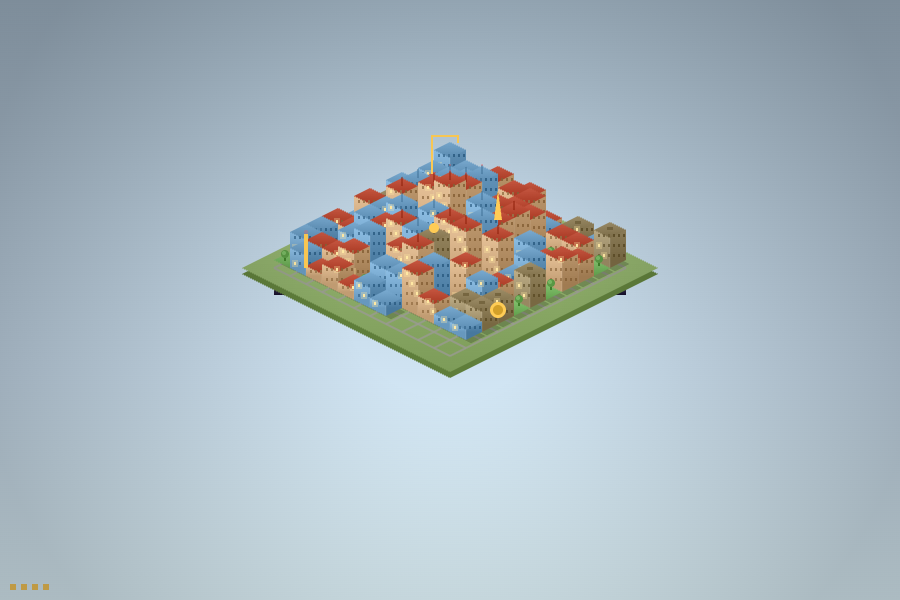
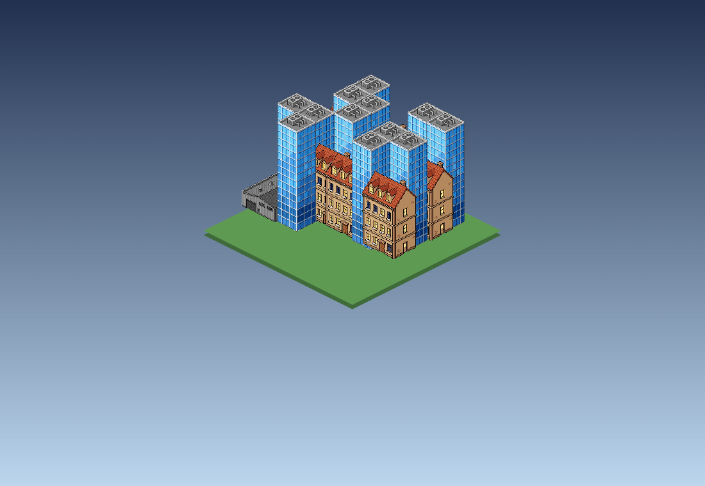

# Tokenopolis



A **cornercase** plugin that turns your token usage into a living city. Start as a tiny low-tech
village; as you burn tokens across sessions, the city grows — denser zones, taller towers, better
infrastructure, higher tech, and eventually *underground*. Go quiet and the economy goes stale:
the city declines into blight and ruins. Come back and it revitalizes. The city is a single,
shareable HTML artifact.

It's **more fun than helpful** — ambient delight, not a productivity tool. The opposite of a
budget tracker: more burn = bigger city.

> 🚧 **Beta** — young and evolving, so expect rough edges. The **styling is wide open to
> iteration**, and this repo is **public**: issues and pull requests are very welcome, especially
> on the look of the city (see [Contributing](#contributing)).

## Privacy

Tokenopolis reads only **usage magnitude** — token counts and timings — and never what you're
working on:

- **cornercase agents** come from `cornercase stats` (numbers only — no prompts, code, models,
  paths, or conversation ids, by platform design).
- **Claude Code (desktop/CLI)** is counted by reading the `usage` token numbers from your
  `~/.claude` transcript files **locally** — only the numbers, never your conversation text.

The two sources are summed, and **nothing is ever sent anywhere** — it all stays on your machine.
(cornercase-run agents live under cornercase's own account dirs, so the two don't double-count.)

The city is served by a small HTTP server **bound to `127.0.0.1` only** (never a public interface),
so the in-city **A Random Act** button can trigger an act. It exposes just the city page and a
`POST /act`; cross-origin requests are refused. Nothing is reachable from outside your machine.

## Install

Once published, enable it from the cornercase marketplace (plugins carrying the
`cornercase-plugin` topic appear at <https://usecornercase.dev/plugins/>). To run from source:

```
cornercase plugin link /path/to/tokenopolis
cornercase plugin enable tokenopolis
```

Then open your city from the **Open Tokenopolis** action (workspace or pane menu).

## How it works

- A background **service** (`city-keeper`) polls `cornercase stats`, runs a pure simulation, and
  re-renders the city into a self-contained `city.html`.
- A `status` **hook** pokes the service to refresh promptly after agent activity.
- City state persists in `CORNERCASE_PLUGIN_STATE` and survives reinstalls.
- **A Random Act** (once an hour): a button in the city rolls a 50-outcome deck — boons grow and
  prettify it, disasters (meteor, quake, flood, …) shrink and wreck it — with a named banner and a
  short animation. The service serves the city on `127.0.0.1` so the button can fire the act; off
  cooldown it glows "ready", otherwise it shows a live countdown. (Opened as a shared/static file
  the button falls back to the ⋯ menu's **A Random Act** action.)
- **v0.4 "Living City":** the city is alive — **day/night** tinting and **seasonal weather** (snow,
  leaves) keyed to the real clock, **citizens & traffic** moving on the streets, and **live growth**
  (the open page polls `/state` and grows in place as you burn, no reload). Plus **achievements** +
  an active-day **streak**, a **chronicle** of the city's events, **legendary** 1-in-25 acts with a
  gold banner, four new **themes** (cyberpunk, solarpunk, blueprint, crt), a **Save postcard** PNG
  export, and cornercase **milestone notifications**.
- **v0.5:** **choose-your-act** (pick between two acts instead of a random roll), **districts** split
  by burn source — Claude Code ("tech") vs cornercase agents ("industry"), tinted on the rooftops —
  and **personalization**: a `flag` emoji by the city name, custom district names, and an optional
  ambient-**audio** toggle (muted by default). Config keys: `cityName`, `theme`, `flag`, `districts`.

See `spec.md` / `clarify.md` / `plan.md` for the full design. Build status: `progress.md`.

## Configuration

Cosmetic only — no effect on the simulation. Create `config.json` in `$CORNERCASE_PLUGIN_CONFIG`:

```json
{ "cityName": "Tokenopolis", "theme": "temperate" }
```

Themes: `temperate · coastal · desert · nordic · neon`. Missing or invalid values fall back to the
defaults. (The config path is assumed to be `$CORNERCASE_PLUGIN_CONFIG/config.json`; confirm against
your cornercase version — see the owed hook/path probe noted in `progress.md`.)

## State & reset

City state lives in `$CORNERCASE_PLUGIN_STATE/` as `state.json` (plus the rendered `city.html` and
`plugin.log`). It survives reinstalls — `cornercase plugin remove` keeps the data folder. To start
over, delete `state.json`; the next run re-baselines at your current lifetime total (grow-from-zero
again).

The `city-keeper` service ticks every 60s and immediately on a `status` event (via a
`refresh.request` poke). It never exits on a tick error; if `cornercase stats` is briefly
unavailable it holds the last-known city and keeps the decay clock running. On SIGTERM/SIGINT it
flushes any in-flight write and exits 0.

## Publishing

Distributed through the cornercase marketplace:

1. Push this folder to its own **public GitHub repo** (it is self-contained — nothing depends on the
   parent directory).
2. Add the repo topic **`cornercase-plugin`**.
3. It appears at <https://usecornercase.dev/plugins/> within ~an hour, re-read on each default-branch
   commit.

Before the first publish, run the real-platform smoke (link + enable in a live cornercase, trigger a
`status` event, open the city) — tracked as the owed pre-publish item in `progress.md`.

## Contributing

Tokenopolis is **public and open to contributions — especially styling.** Great places to start:

- **Themes / palettes** → `src/render/themes.js` (five palettes today — refine them or add your own)
- **The renderer** → `src/render/draw.js` (isometric buildings, lit windows, roads, infra tiers,
  damage/ruins, animation)
- **City shape** → `src/render/scene.js` (zoning, density, LOD, landmarks, underground)
- **Preview your changes** → `node scripts/gallery.mjs` renders six canonical states
  (hamlet → metropolis → ruins → rebuilt) side by side into `gallery.html`

Before a PR: `npm install` (dev-only TOML parser) then `node --test` — the suite is fast and
zero-config. Keep the simulation deterministic and the artifact self-contained (no network, no
external references). Open issues / PRs at <https://github.com/AeiltAbraham/tokenopolis>.

## Art direction

The hero above is what the plugin **actually renders** — a lightweight, animated, self-contained
vector city (~10 KB, no assets). Separately, we're exploring a hand-drawn pixel-art look with
AI-generated isometric sprites (Nano Banana / Gemini). This is **concept art, not the current
output** — a possible future "high-detail" direction:



A full sprite tileset (height variants per zone, ruin/decay states, underground, animation) is a
real project — contributions toward it are very welcome (see [Contributing](#contributing)).

## Layout

```
cornercase-plugin.toml   manifest (service, status hook, open-city action)
src/sim/                 pure simulation (scale, economy, vitality/decay) — no I/O
src/render/              scene generator + isometric canvas renderer + themes
src/                     stats adapter, state store, artifact assembler, config, tick
service/                 the long-running keeper
scripts/                 poke, open-city, stats assert, LOD score, gallery, smokes
test/                    node:test suites + fixtures
```
